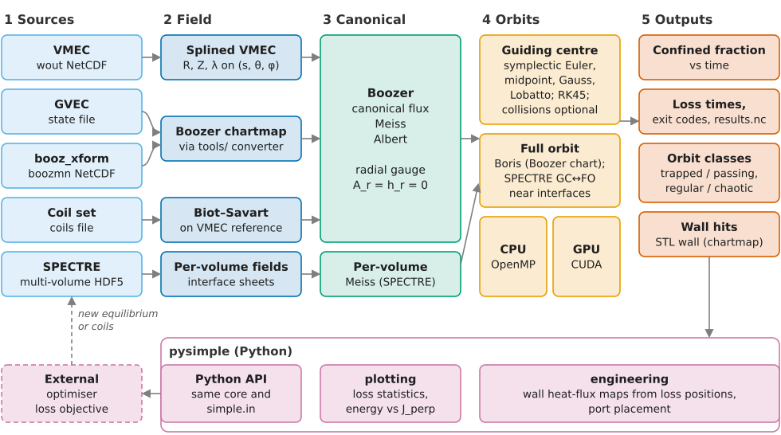

[](https://zenodo.org/badge/latestdoi/146476544)

# SIMPLE

**S**ymplectic **I**ntegration **M**ethods for **P**article **L**oss **E**stimation

SIMPLE traces guiding-centre orbits of energetic particles, by default 3.5 MeV
fusion alphas, in three-dimensional magnetic fields and reports when and where
they leave the plasma. It integrates in canonical coordinates with symplectic
schemes and classifies orbits as regular or chaotic, which makes alpha-loss
estimates cheap enough for stellarator optimisation loops.

- Field input: VMEC equilibria, Boozer chartmaps (GVEC, booz_xform), coil
  files, SPECTRE multi-volume equilibria.
- Physics options: collisions with a background plasma, fusion-weighted
  alpha births, STL wall intersection, orbit classification, full orbits.
- OpenMP over particles, an optional native CUDA backend, and the Python
  package `pysimple`.



## Build and run

With GNU Fortran, CMake ≥ 3.22, Ninja, NetCDF-C/Fortran and BLAS/LAPACK installed:

```bash
git clone https://github.com/itpplasma/SIMPLE.git && cd SIMPLE
make
mkdir -p run && cp examples/simple.in run/
curl -L -o run/wout.nc https://github.com/hiddenSymmetries/simsopt/raw/master/tests/test_files/wout_LandremanPaul2021_QA_reactorScale_lowres_reference.nc
(cd run && ../build/simple.x simple.in && tail -1 confined_fraction.dat)
```

This traces 128 alphas for 10 ms in a public quasi-axisymmetric reactor
equilibrium. The [quick start](https://itpplasma.github.io/SIMPLE/latest/getting-started/quickstart.html)
explains the output; the [installation guide](https://itpplasma.github.io/SIMPLE/latest/getting-started/installation.html)
covers packages per platform, CMake options and `pysimple`.

## Documentation

Manual: <https://itpplasma.github.io/SIMPLE/latest/>. Contributing:
[CONTRIBUTING.md](CONTRIBUTING.md). Mirror with release tags:
<https://gitlab.eufus.psnc.pl/itpplasma/simple>.

## Cite

Cite the methods your study uses:

- Symplectic guiding-centre integration: Albert, Kasilov, Kernbichler,
  J. Comput. Phys. 403, 109065 (2020), [doi:10.1016/j.jcp.2019.109065](https://doi.org/10.1016/j.jcp.2019.109065).
- Accelerated alpha-loss computation: Albert, Kasilov, Kernbichler,
  J. Plasma Phys. 86, 815860201 (2020), [doi:10.1017/S0022377820000203](https://doi.org/10.1017/S0022377820000203).
- Orbit classification: Albert et al., J. Plasma Phys. 89, 955890301 (2023),
  [doi:10.1017/S0022377823000351](https://doi.org/10.1017/S0022377823000351).
- Wall heat loads: Albert et al., Nucl. Mater. Energy 48, 102200 (2026),
  [doi:10.1016/j.nme.2026.102200](https://doi.org/10.1016/j.nme.2026.102200).

Full references: [publications page](https://itpplasma.github.io/SIMPLE/latest/reference/publications.html)
and [CITATION.cff](CITATION.cff).

## License

[MIT](LICENSE). The FIRM3D-compatible tracing path has separate
[provenance and license information](LICENSES/FIRM3D-MIT.txt).
