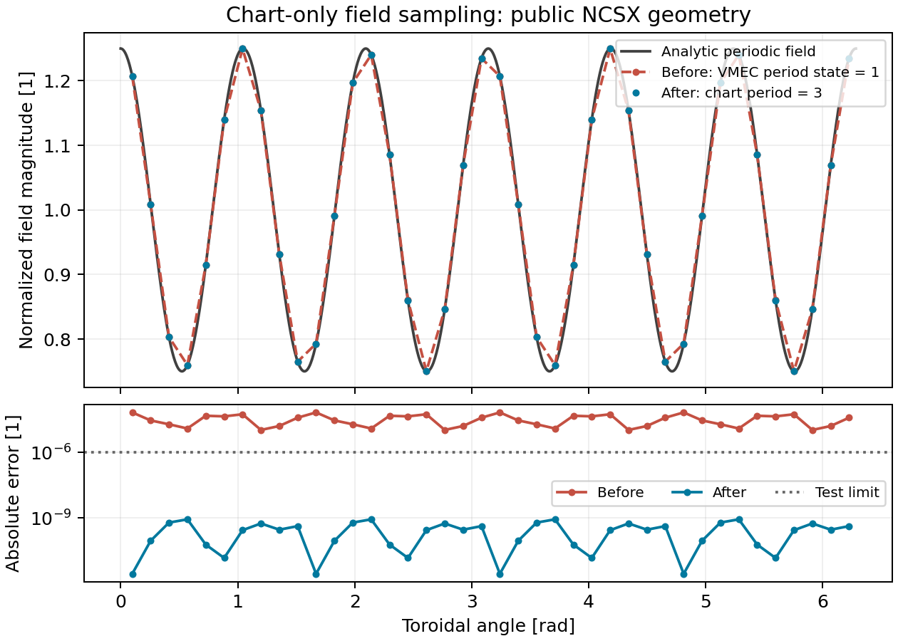

# Chart-only field sampling regression

The public NCSX chart has three field periods. The analytic Cartesian field is
$B_z=1+0.25\cos(6\varphi)$, with zero transverse field and normalized magnitude.
The test deliberately leaves the unrelated VMEC period state at one.

The samples come from `test_refcoords_cartesian_axis` in SIMPLE. All inputs are
synthetic or the public NCSX geometry; no experimental case data appears here.
The plotted absolute error limit is $10^{-6}$ in normalized field magnitude.
