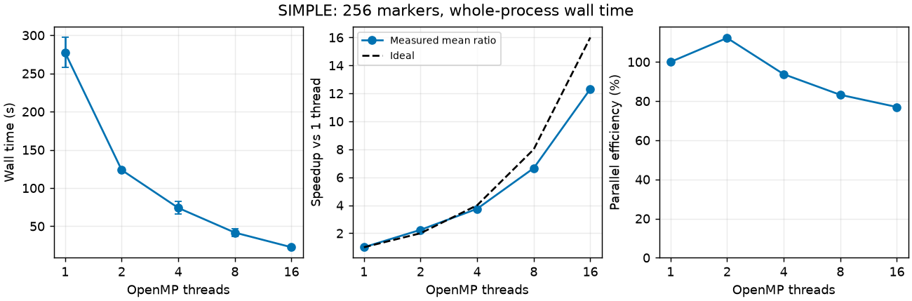
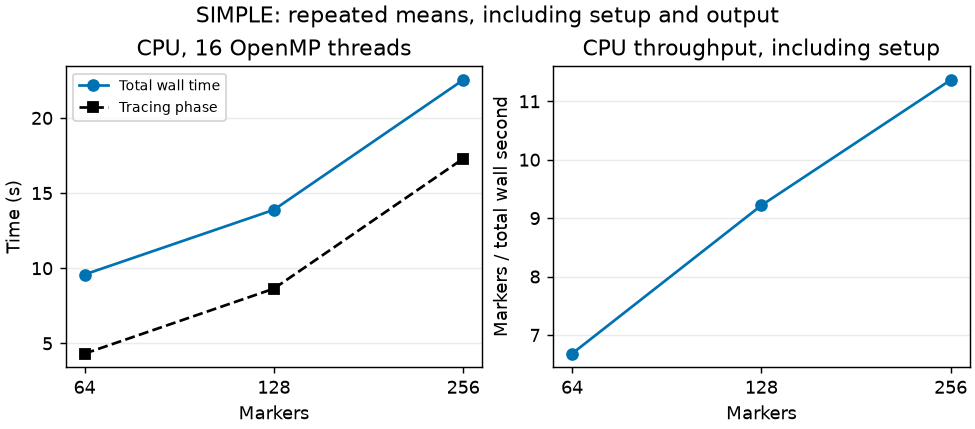

OpenMP scaling and CUDA measurements
====================================

Measurement scope
-----------------

These measurements use SIMPLE physics sources at
``fe2de273681642ed1f651d3c14c5e23e398fb458`` on a shared Linux
workstation, 2026-10-18. They cover OpenMP scaling for one public VMEC
equilibrium and a CUDA production attempt that stopped before kernel
launch. Pitagora execution and H100 throughput remain unmeasured; see
the :download:`Pitagora deployment templates <../../hpc/pitagora.md>`.

:download:`Build metadata <build-metadata.json>` records executable hashes,
dependency commits and compiler flags. The timing tables below retain
every repetition. The equilibrium is fetched separately using the pinned
URL below.

Machine and build
-----------------

``lscpu``, ``free -h`` and ``nvidia-smi`` identify an AMD Ryzen 9 5950X
(16 physical cores, 32 hardware threads), 94 GiB host RAM and two NVIDIA
RTX 5060 Ti devices (16,311 MiB each, compute capability 12.0). Only
device 0 was made visible to GPU measurements. This is a shared
workstation; other jobs were active, clocks were not locked and caches
were not flushed. These are observed application timings under
contention, not dedicated-node baselines.

The measured binaries used Release, OpenMP and
``SIMPLE_DETERMINISTIC_FP=OFF``. GNU Fortran/C/C++ were GCC 16.2.1
(20260810), CMake 4.4.4, Ninja 1.13.2, CUDA 13.4.92 and NVIDIA driver
615.78.08. NVIDIA Fortran 26.9-0 was installed but was not used: the
documented CUDA backend supports GNU Fortran. The principal SIMPLE
Fortran flags were
``-O3 -ffast-math -ffp-contract=fast -funroll-loops -march=x86-64-v2 -mtune=native -fopenmp``,
plus diagnostics and ``-g``. CUDA used architecture ``120``, C++17,
``-O3 --generate-line-info --extra-device-vectorization -Xptxas=-v``.
See the metadata for the generated command flags, including the host
flags.

Actual dependency commits from
``git -C build/_deps/<name>-src rev-parse HEAD`` were:

========== ============================================
Dependency Commit
========== ============================================
libneo     ``f6090e8150c2f5b1c0afde09baadf79b50b1ffe7``
fortnum    ``1a52e13c5e28b09d083947a6ec7e8a1dcf9d502e``
fortplot   ``5daec54649e305fd09bc1ef8345511d5692a1889``
fortio     ``38add03dc691a7cd4715cd3e611ad42422e46091``
========== ============================================

Public physics case and measurement protocol
--------------------------------------------

The input is the public simsopt
``wout_LandremanPaul2021_QA_reactorScale_lowres_reference.nc``, the same
QA reactor-scale equilibrium linked by SIMPLE’s README. The fetched file
has SHA256
``333ab8cef64c4b4f406e76209266fc3bf4d7976e9c28c162983c2120e112e771``.
The reproduction URL below pins simsopt commit
``81436b4f7c655a4099eadadb168b7cc27923e555``.

The common configuration is ``sbeg=0.3`` (normalized toroidal flux),
Boozer guiding-center tracing (``isw_field_type=2``),
``trace_time=0.01 s``, ``ntimstep=1001``, ``npoiper2=128``,
``integmode=0`` (adaptive CPU RK45), ``relerr=1e-9``,
``contr_pp=-1e100``, ``notrace_passing=0``, and deterministic sampling
with seed 42. Other settings retain the defaults in
``examples/simple_full.in``. There are no collisions, walls, classifiers
or orbit trajectory output. The attempted GPU production run selects
native CUDA DOPRI with the same field, starts, physical duration and
relative tolerance. These are different adaptive implementations, not
identical integrators.

GPU settings are ``gpu_landreman=.true.``, one device,
``gpu_t_block=0.01``, ``gpu_loss_tau=1``, ``gpu_maxloss=1``, and
``gpu_min_timestep=0``. The full-duration block and permissive loss
controls avoid intentional early stopping in this comparison. Reported
observed physical duration must still be checked in the production log.

Each measurement starts a fresh process and includes setup, sampling,
tracing and output in Python’s monotonic wall timer. The separate
tracing timer is read from SIMPLE stdout (``src/simple_main.f90:314`` on
CPU; ``:1125`` on GPU). There is no warm-up subtraction. Runs are
sequential; thread counts descend in repetition 1 and ascend in
repetition 2. ``OMP_PLACES=cores``, ``OMP_PROC_BIND=spread``,
``OMP_DYNAMIC=FALSE`` and ``OMP_THREAD_LIMIT=16`` are fixed. BLAS
threads are limited to one. The existing marker loop uses OpenMP
``schedule(dynamic,1)`` at ``src/simple_main.f90:842-848``.

The default CPU passing shortcut (``contr_pp=-1``) is disabled for
backend comparisons: ``src/params.f90:728`` and
``src/simple_main.f90:1918-1927`` otherwise skip deeply passing markers
and count them as confined. CUDA production traces them. The runner
rejects exit code 3 (skipped) and verifies that each output contains the
requested marker count. Calibration runs are excluded from the retained
scaling means.

Reproduce
---------

The following commands reproduce the build and measurement protocol,
with the input URL and libneo ref pinned explicitly through ``FLAGS``.
Run from the repository root; all generated files remain inside this
worktree. The Python scripts require NumPy and Matplotlib.

.. code:: bash

   export CC=gcc CXX=g++ FC=gfortran
   export CMAKE_BUILD_PARALLEL_LEVEL=16 OPENBLAS_NUM_THREADS=1
   make CONFIG=Release \
     FLAGS='-DLIBNEO_REF=f6090e8150c2f5b1c0afde09baadf79b50b1ffe7 -DENABLE_PYTHON_INTERFACE=OFF -DSIMPLE_ENABLE_PYTHON_TOOLS=OFF -DSIMPLE_ENABLE_CUDA=OFF -DSIMPLE_DETERMINISTIC_FP=OFF'
   cmake -S . -B build-cuda -G Ninja -DCMAKE_BUILD_TYPE=Release \
     -DSIMPLE_ENABLE_CUDA=ON -DSIMPLE_DETERMINISTIC_FP=OFF -DCMAKE_CUDA_ARCHITECTURES=120 \
     -DCMAKE_CUDA_COMPILER=/opt/cuda/bin/nvcc \
     -DENABLE_PYTHON_INTERFACE=OFF -DSIMPLE_ENABLE_PYTHON_TOOLS=OFF \
     -DLIBNEO_SOURCE_DIR="$PWD/build/_deps/libneo-src"
   cmake --build build-cuda --target simple.x test_cuda_native_rk54.x test_cuda_native_bridge.x
   mkdir -p build/evidence
   curl -L --fail 'https://raw.githubusercontent.com/hiddenSymmetries/simsopt/81436b4f7c655a4099eadadb168b7cc27923e555/tests/test_files/wout_LandremanPaul2021_QA_reactorScale_lowres_reference.nc' \
     -o build/evidence/wout.nc
   sha256sum build/evidence/wout.nc
   python tools/perf/efss_scaling.py --wout build/evidence/wout.nc \
     --output build/evidence/full-strong256 --markers 256 --threads 16 8 4 2 1
   python tools/perf/efss_scaling.py --wout build/evidence/wout.nc \
     --output build/evidence/markers128 --markers 128 --threads 16
   python tools/perf/efss_scaling.py --wout build/evidence/wout.nc \
     --output build/evidence/markers64 --markers 64 --threads 16
   python tools/perf/efss_scaling.py --executable build-cuda/simple.x --gpu --timeout 300 \
     --wout build/evidence/wout.nc --output build/evidence/gpu --markers 256 --threads 16
   python tools/perf/plot_efss_scaling.py build/evidence/full-strong256/measurements.csv \
     build/evidence/strong-scaling.png

Reproduction needs fresh output directories: the runner deliberately
refuses to overwrite per-run directories. Every run retains
``simple.in``, ``stdout.log``, ``start.dat``, ``confined_fraction.dat``,
``unresolved_fraction.dat``, ``times_lost.dat`` and
``orbit_exit_code.dat`` under ``build/evidence/`` locally. Keep these
outputs to check marker completion and numerical agreement alongside
timing results.

Strong scaling
--------------

The retained case has **256 markers**, with two repetitions at every
thread count. :download:`Raw repetitions <strong-scaling.csv>` and :download:`run metadata <strong-metadata.json>` retain the unrounded values. Speedup
is mean one-thread wall time divided by mean wall time; efficiency is
speedup divided by thread count. Plot error bars show the observed
minimum and maximum, not confidence intervals.

+---------+---------+---------+---------+---------+---------+------------+
| Threads | Wall r1 | Wall r2 | Mean    | Mean    | Speedup | Efficiency |
|         | (s)     | (s)     | wall    | tracing |         |            |
|         |         |         | (s)     | (s)     |         |            |
+=========+=========+=========+=========+=========+=========+============+
| 1       | 297.13  | 257.73  | 277.43  | 271.63  | 1.00    | 100.0%     |
+---------+---------+---------+---------+---------+---------+------------+
| 2       | 123.16  | 124.03  | 123.59  | 118.19  | 2.24    | 112.2%     |
+---------+---------+---------+---------+---------+---------+------------+
| 4       | 65.76   | 82.23   | 74.00   | 68.71   | 3.75    | 93.7%      |
+---------+---------+---------+---------+---------+---------+------------+
| 8       | 37.03   | 46.34   | 41.68   | 33.81   | 6.66    | 83.2%      |
+---------+---------+---------+---------+---------+---------+------------+
| 16      | 22.50   | 22.55   | 22.53   | 17.29   | 12.32   | 77.0%      |
+---------+---------+---------+---------+---------+---------+------------+

The 16-thread mean tracing speedup is 15.71 (efficiency 98.2%). Every
CPU fraction curve agrees exactly (maximum absolute difference 0,
acceptance tolerance 1e-12). Sampled final confinement is 1 and
unresolved fraction is 0. The saved outputs contain finite, identical
full ``times_lost.dat`` arrays across all ten runs, with 256 completed
exit codes and no skipped or numerical exit codes per run. Each marker
reaches the requested 0.01 s duration. The benchmark runner checks
identical starts and time grids, not only final fractions.

Marker-count scaling
--------------------

Two runs each at 64, 128 and 256 markers use 16 threads, the same
equilibrium, seed and physical duration. This is marker-count scaling,
not multi-node weak scaling. The smaller ensembles have different
sampling workloads; their per-marker costs need not be identical.
Sources: :download:`64 <markers64.csv>`, :download:`128 <markers128.csv>` and the
16-thread rows of :download:`256 <strong-scaling.csv>`.

+-----------+-----------+-----------+-----------+-----------+-----------+
| Markers   | Wall r1   | Wall r2   | Mean wall | Mean      | Markers / |
|           | (s)       | (s)       | (s)       | tracing   | wall s    |
|           |           |           |           | (s)       |           |
+===========+===========+===========+===========+===========+===========+
| 64        | 9.58      | 9.58      | 9.58      | 4.31      | 6.68      |
+-----------+-----------+-----------+-----------+-----------+-----------+
| 128       | 13.89     | 13.89     | 13.89     | 8.64      | 9.22      |
+-----------+-----------+-----------+-----------+-----------+-----------+
| 256       | 22.50     | 22.55     | 22.53     | 17.29     | 11.36     |
+-----------+-----------+-----------+-----------+-----------+-----------+

CPU profile
-----------

The SIMPLE-only perf profile samples user cycles at 99 Hz for the same
256-marker, 16-thread case. It contains about 27k samples and reports
zero lost samples. The profiled run is excluded from timing means.
Percentages are self shares of sampled cycles, not wall-time shares.

+--------------------------------------------+---------------------------+---------------------------------------------------+
| Named hotspot                              | Self share                | Source at the recorded commits                    |
+============================================+===========================+===================================================+
| 3-D batch spline derivatives,              | 41.20%                    | libneo                                            |
| ``evaluate_batch_splines_3d_der_core_nq1`` |                           | ``src/interpolate/batch_interpolate_3d.f90:1205`` |
+--------------------------------------------+---------------------------+---------------------------------------------------+
| 1-D batch spline derivatives,              | 11.73%                    | libneo                                            |
| ``evaluate_batch_splines_1d_der2_core``    |                           | ``src/interpolate/batch_interpolate_1d.f90:48``   |
+--------------------------------------------+---------------------------+---------------------------------------------------+
| ``splint_boozer_coord_device``             | 4.18%                     | libneo ``src/boozer_converter.F90:269``           |
+--------------------------------------------+---------------------------+---------------------------------------------------+
| ``velo_can``                               | 3.71%                     | SIMPLE ``src/sub_alpha_lifetime_can.f90:324``     |
+--------------------------------------------+---------------------------+---------------------------------------------------+
| ``magfie_boozer``                          | 2.22%                     | SIMPLE ``src/magfie_can_boozer.f90:113``          |
+--------------------------------------------+---------------------------+---------------------------------------------------+

The two leading spline routines account for 52.93% together. Several
sizeable libgfortran frames remain unsymbolized in this installation,
including 6.92% and 6.09% entries. No optimization or solver change is
proposed from this single profile.

CUDA execution block and Nsight capture
---------------------------------------

The attempted direct-VMEC production configuration exited with status 1
before CUDA tracing. The
application log identifies ``src/simple_cuda_native.f90:133``: **native
CUDA RK requires initialized compact Boozer tables**, reached from
``src/simple_main.f90:1052``. The production bridge checks
``rk_tables_ready`` and both table allocations at lines 131–133. The
attempted configuration and executable hash are in :download:`GPU metadata <gpu-metadata.json>`.

``gpu_compact_init`` is not a drop-in switch for this VMEC case:
``src/simple_main.f90:500–504`` requires a Boozer chartmap, Boozer
starts and no wall. No alternative-field performance number is available
for this case.

Nsight Systems 2026.3.2 reproduced the same pre-kernel failure. The
recorded Nsight report contains no CUDA kernel data and no CUDA API
trace data. Thus GPU markers/s, CPU/GPU physical agreement and GPU hot
spots for this VMEC configuration are **not measured**. The compare
tool’s aggregate engineering threshold (2/N for each fraction curve) is
unit-tested but is not claimed as an executed VMEC CPU/GPU comparison.
Confinement is normalized to resolved markers; unresolved fractions use
the full ensemble. This threshold does not bound the number of paired
marker-status changes and is not a statistical confidence bound.

.. code:: bash

   perf record -e cycles:u -F 99 -o build/evidence/cpu-profile.data -- \
     python tools/perf/efss_scaling.py --wout build/evidence/wout.nc \
     --output build/evidence/cpu-profile --markers 256 --threads 16 --repetitions 1
   perf report -i build/evidence/cpu-profile.data --stdio --no-children \
     --comms=simple.x --percent-limit 1
   nsys profile --trace=cuda,osrt --sample=none --cpuctxsw=none --force-overwrite=true \
     -o build/evidence/gpu-profile python tools/perf/efss_scaling.py \
     --executable build-cuda/simple.x --gpu --timeout 300 \
     --wout build/evidence/wout.nc --output build/evidence/gpu-profile-run \
     --markers 256 --threads 16 --repetitions 1
   nsys stats --report cuda_gpu_kern_sum,cuda_api_sum --format csv \
     build/evidence/gpu-profile.nsys-rep
   MPLCONFIGDIR=build/evidence/mpl python tools/perf/plot_efss_throughput.py \
     --cpu build/evidence/markers64/measurements.csv \
     build/evidence/markers128/measurements.csv build/evidence/full-strong256/measurements.csv \
     --output build/evidence/marker-throughput.png

Interpretation and limits
-------------------------

End-to-end scaling includes fresh field initialization, sampling and
output on every run. At 16 threads the mean tracing phase is 17.292 s,
versus 22.526 s total. Throughput rises with marker count over the
measured range as the fixed setup cost is spread across more markers.
All retained sampled markers are confined; this is not broad
loss-physics validation.

Contention, cache effects and frequency changes can contribute to the
observed variation and the greater-than-100% two-thread efficiency. This
two-repetition shared-machine campaign cannot isolate their
contributions or predict Pitagora performance. No algorithmic
optimization is inferred.

Pitagora modules, Slurm execution, H100 throughput and cross-socket
scaling remain untested. Validate the published templates in an
allocated debug job before production use. Native CUDA VMEC
initialization needs resolution or a separately verified equivalent
chartmap workflow before a production CPU/GPU comparison can be
reported.

Test configuration
------------------

Run the focused native checks below with deterministic floating point ON.
The timing tables use Release/OFF executables identified by the recorded
hashes. Passing native CUDA unit tests does not establish production
throughput or CPU/GPU agreement.

.. code:: bash

   CMAKE_BUILD_PARALLEL_LEVEL=16 OPENBLAS_NUM_THREADS=1 OMP_NUM_THREADS=4 OMP_THREAD_LIMIT=4 \
     make test CONFIG=Release \
     FLAGS='-DLIBNEO_REF=f6090e8150c2f5b1c0afde09baadf79b50b1ffe7 -DENABLE_PYTHON_INTERFACE=OFF -DSIMPLE_ENABLE_PYTHON_TOOLS=OFF' \
     TEST='test_config_reference|test_orbit_symplectic_base|test_ntcut_overflow'
   CUDA_VISIBLE_DEVICES=0 CMAKE_BUILD_PARALLEL_LEVEL=16 OPENBLAS_NUM_THREADS=1 OMP_NUM_THREADS=4 OMP_THREAD_LIMIT=4 \
     make test CONFIG=Release BUILD_DIR=build-cuda \
     FLAGS='-DSIMPLE_ENABLE_CUDA=ON -DCMAKE_CUDA_ARCHITECTURES=120 -DENABLE_PYTHON_INTERFACE=OFF -DSIMPLE_ENABLE_PYTHON_TOOLS=OFF' \
     TEST='test_cuda_native_(rk54|bridge)'
   python -m unittest discover -s tools/perf -p test_efss_scaling.py
   bash -n examples/hpc/pitagora/dcgp.slurm examples/hpc/pitagora/booster.slurm

The tool unit tests cover output validation and comparison thresholds.
Slurm syntax checks do not validate scheduler execution or the module
environment. The full regression, slow and Python solver suites were not
run for these measurements. Runs use at most 16 OpenMP threads and one
visible GPU.
